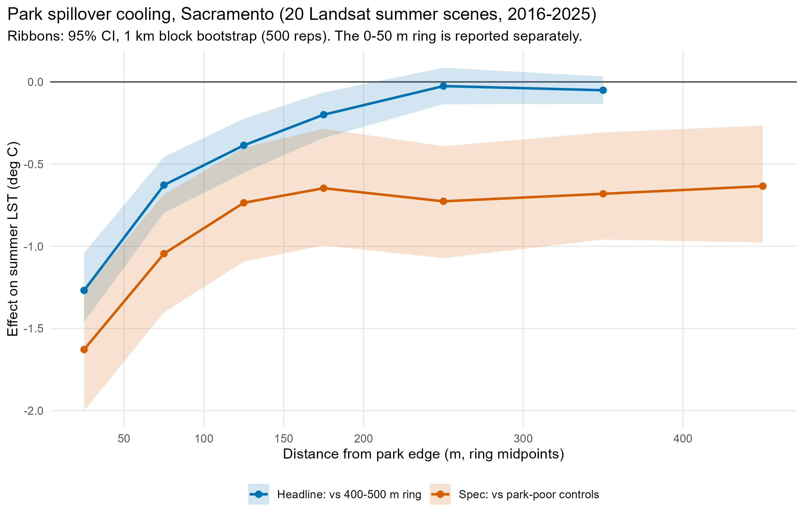
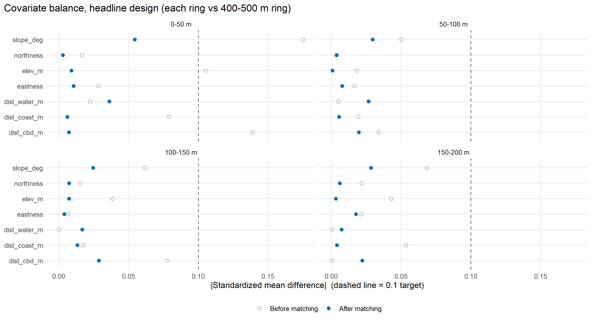
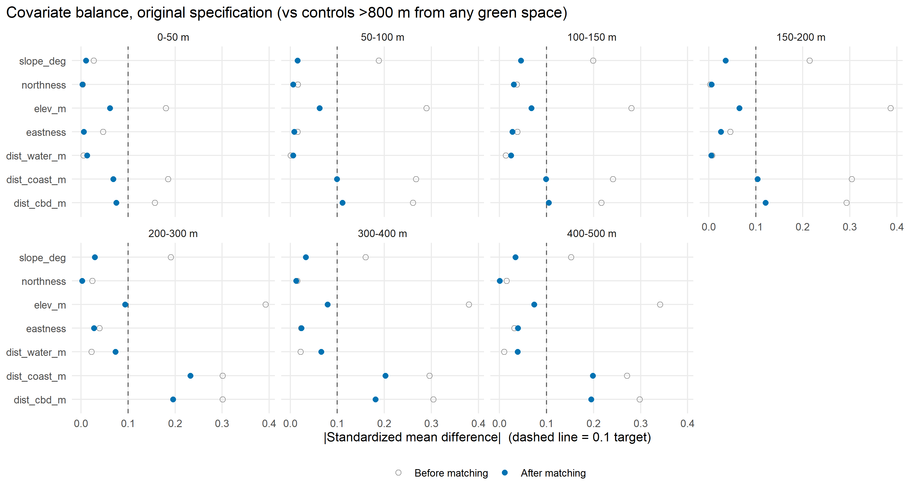
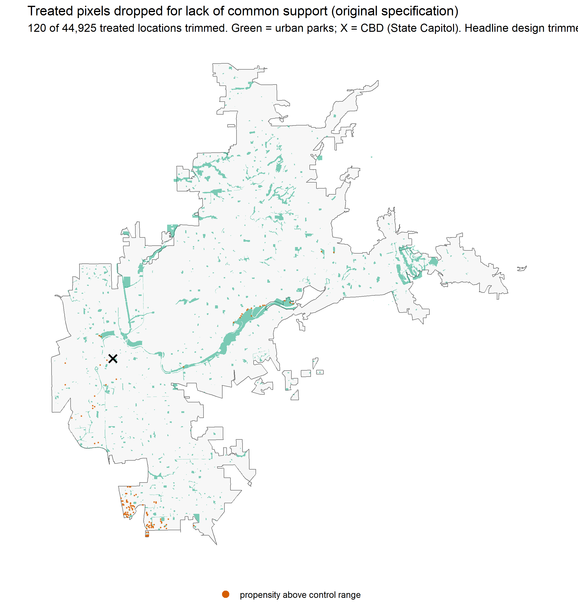
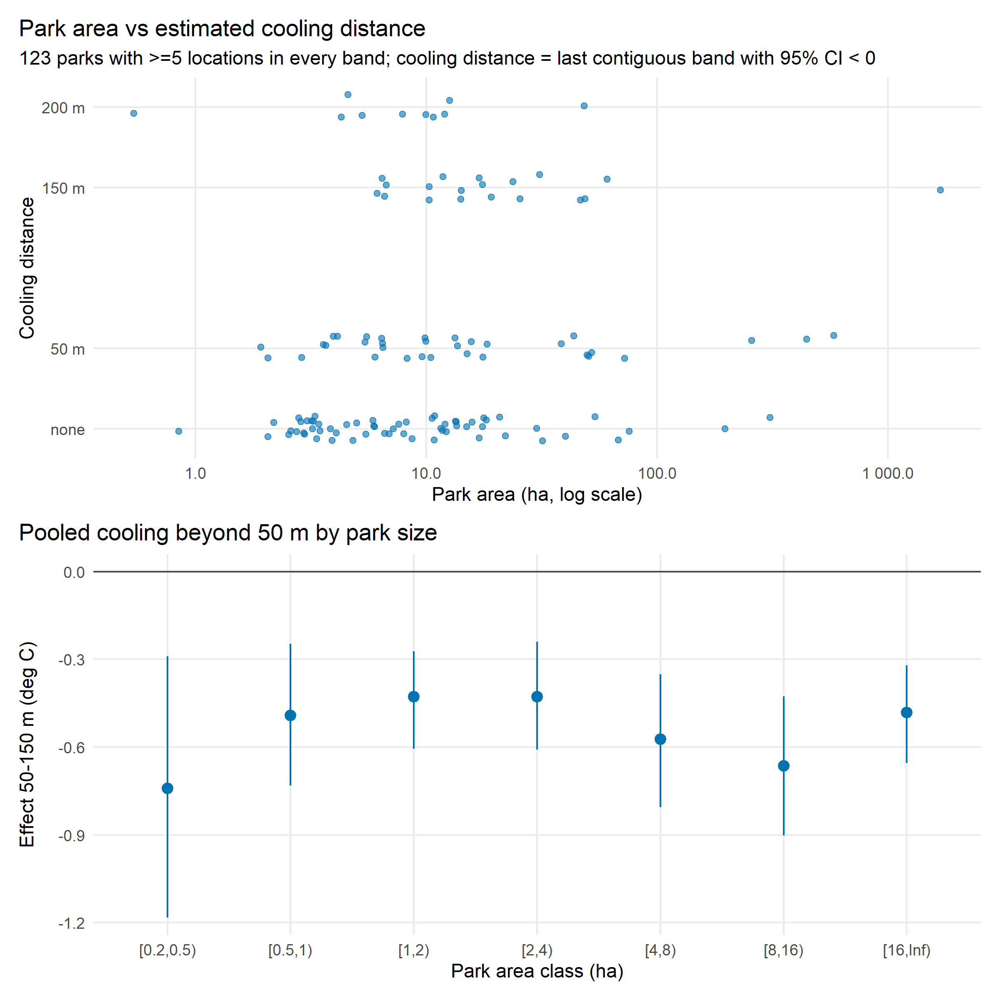
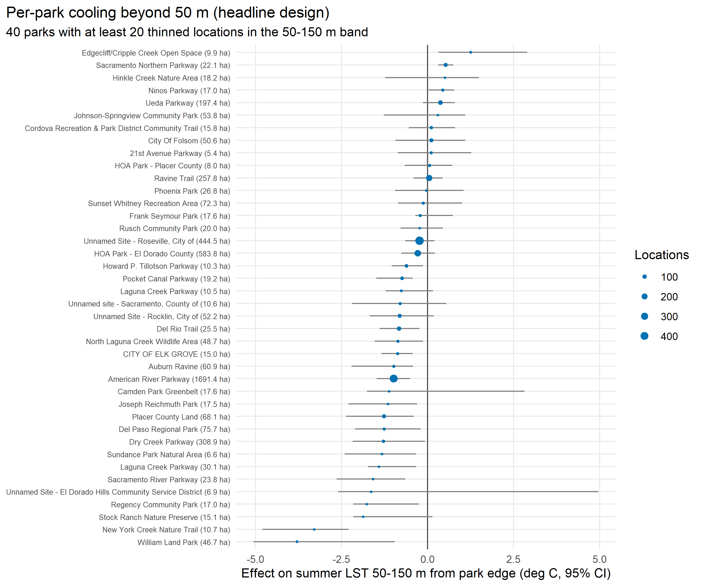

# Do Parks Cool the Streets Around Them? Matched-Pixel Evidence from Sacramento, 2016–2025

**Personal portfolio project (individual work)** · Chinmoy Ghosh Shuvo · October 2026

## Summary

How far does a park's cooling reach into the neighbourhood around it? I used 20 smoke-free summer Landsat 8/9 scenes (2016–2025) and 790 urban parks in Sacramento, California. For each 30 m pixel at a set distance from a park edge, I found a statistically matched pixel farther from the same parks, imaged on the same day, and compared their ground temperatures. Neighbourhoods next to parks are **about 0.6 °C cooler at 50–100 m**, 0.4 °C at 100–150 m and 0.2 °C at 150–200 m, and **no cooler beyond about 200 m**. Of the park traits tested, **tree canopy** is the only one that clearly predicts how much a park cools its surroundings; park size does not. The repository contains the full R pipeline, the covariate balance and sensitivity diagnostics, and the full record of its robustness checks.

*Blue: headline design, each distance band against matched pixels 400–500 m from the same parks. Orange: the original specification, against pixels more than 800 m from any green space. Ribbons are 95% confidence intervals from a 1 km block bootstrap.*

## Question and design

Comparing temperatures near and far from parks mixes the park's effect with everything else that differs between those places, such as height above the river, nearness to water and distance from downtown. This project uses **matching**. For each pixel near a park, it finds another pixel with the same terrain and the same distances to water, downtown and the Delta, on the same Landsat date, and compares the two. The average difference across these pairs estimates how much cooler park-adjacent pixels are because of the park (the average treatment effect on the treated, ATT), separately for each distance band from the edge.

The main specification deliberately does **not** match on present-day building density. Parks affect how densely the land around them is built, so controlling for density could hide part of their effect. Density is added only in a comparison run.

The design was first written for Chattogram, Bangladesh. This Sacramento run is a pilot: summer skies there are reliably clear, the terrain is flat, one Landsat tile covers the whole city, and California keeps a complete public inventory of parks.

## Study area

**Sacramento, California:** the 2020 Census urban area "Sacramento, CA", 1,224 km², analysed on the native 30 m Landsat grid (WGS 84 / UTM 10N).

## Data

| Dataset | Used for | Resolution / period |
|---|---|---|
| Landsat 8/9 Collection 2 Level-2 (surface temperature, red, NIR, QA and aerosol bands) via the Microsoft Planetary Computer STAC API | Land surface temperature (LST), NDVI, cloud and water masks, smoke screening | 30 m; 20 scenes, 25 June–20 August, 2016–2025 |
| California Protected Areas Database (CPAD) 2026a, CNRA map service | Parks and other protected open space | Vector; 3,025 holdings |
| OpenStreetMap (`leisure=park`, `leisure=garden`, `landuse=recreation_ground`) | Cross-check for parks missing from CPAD | Vector |
| Copernicus DEM GLO-30 | Elevation, slope, aspect | 30 m |
| JRC Global Surface Water (occurrence > 50%) | Permanent water and distance to it | 30 m |
| Microsoft US Building Footprints | Building cover within 150 m (scope restriction and comparison run) | 666,861 footprints in the window |
| GHSL GHS-BUILT-S 1975 (R2023A) | Negative-control outcome | 100 m |
| ESA WorldCover 2021 | Tree canopy and water inside each park | 10 m |
| Natural Earth 1:10m coastline | Distance to the coast (here, the Sacramento–San Joaquin Delta) | Vector |
| US Census TIGER 2023 urban areas | Study area boundary | Vector |

## Method

1. **Scene choice.**
   - Searched 284 summer Landsat 8/9 scenes (June–September, Tier 1). 92 came from the one tile that covers the whole city (path 44, row 33).
   - Kept scenes at least 85% clear that also had no more than 10% high-aerosol pixels. The aerosol screen removed wildfire-smoke days, such as 25 Aug 2020 and 28 Aug 2021, that the cloud mask had passed as clear.
   - Took the two scenes per year closest to 31 July, giving 20 scenes (14 Landsat 8, 6 Landsat 9), all at least 99.7% clear over the city.
2. **LST and NDVI.**
   - Applied the USGS scale factors: LST (°C) = DN × 0.00341802 + 149.0 − 273.15; reflectance = DN × 0.0000275 − 0.2.
   - Masked fill, dilated cloud, cirrus, cloud, cloud shadow and water using the QA band.
3. **Parks.**
   - Merged the CPAD holdings into 1,019 park units and kept those of at least 0.2 ha with a summer median NDVI above 0.3, leaving 850.
   - The **urban parks** used as treatment are units more than half owned by a city, county, park and recreation district, community services district or homeowners' association, excluding golf courses, cemeteries and planned parks. That gives **790 parks, 7,407 ha, median 2.2 ha**.
4. **Pixel pools.**
   - Treated pixels are land 0–500 m from an urban-park edge, in seven distance bands, plus park interiors.
   - Pixels inside any CPAD or OSM green space, or on permanent water, are excluded.
   - All pools are thinned to one pixel per 120 m to limit spatial autocorrelation.
   - The analysis covers **built neighbourhoods** only: pixels with at least 2% building cover within 150 m. This rule was fixed before any estimate was made.
5. **Matching.**
   - Matched on elevation, slope, aspect (north–south and east–west components), and distance to permanent water, to downtown (the State Capitol) and to the Delta coastline.
   - Treated pixels outside the controls' propensity-score range were trimmed.
   - Coarsened exact matching was tried first, but it kept only 3–5% of treated pixels. Under the rule set in advance, every band therefore used Mahalanobis nearest-neighbour matching instead: 1:1, without replacement, with a 0.2 SD caliper on the propensity logit, and exact on scene date so no pair spans two days.
6. **Estimation.**
   - The ATT is the matched mean difference, with a doubly robust regression on the matched set as a check.
   - 95% confidence intervals come from a block bootstrap over 1 km grid cells (500 replicates, matching held fixed). No standard error treats pixels as independent.
7. **Two control groups.**
   - *Original specification:* pixels more than 800 m from any green space and from permanent water.
   - *Headline:* matched pixels 400–500 m from urban parks. I added this after the original specification showed a flat cooling of about 0.65 °C all the way to 500 m, a pattern that points to park-poor neighbourhoods differing from park-adjacent ones rather than to park cooling. Because it was added after the first results, the next step is to confirm it in a second city with the design fixed in advance.
8. **Sensitivity checks** (decision rules written before running):
   - A negative control: 1975 built-up area as the outcome, for parks established after 1975. Matched pixels should not differ.
   - Placebo parks: real park shapes moved at random into control territory.
   - Rosenbaum bounds.
9. **Park-level analysis.**
   - Cooling for each park at 0–50, 50–150 and 150–200 m.
   - Pooled estimates by park-size class.
   - A regression on area, perimeter-to-area ratio, canopy share and internal water.

## Results

### Cooling by distance from the park edge (headline design)

| Distance from park edge | Effect on summer LST | 95% CI | Doubly robust | Negative control |
|---|---|---|---|---|
| 0–50 m | −1.27 °C | −1.46 to −1.04 | −1.26 | flagged |
| 50–100 m | **−0.63 °C** | −0.80 to −0.46 | −0.67 | passed |
| 100–150 m | **−0.39 °C** | −0.55 to −0.22 | −0.42 | passed |
| 150–200 m | **−0.20 °C** | −0.34 to −0.06 | −0.23 | passed |
| 200–300 m | −0.03 °C | −0.14 to 0.09 | −0.13 | passed |
| 300–400 m | −0.05 °C | −0.13 to 0.03 | −0.05 | passed |
| Park interior (on site) | −2.79 °C | −3.27 to −2.30 | — | flagged |

*Source: [`data/diagnostic_vs_400_500m_ring.csv`](data/diagnostic_vs_400_500m_ring.csv), [`data/headline_onsite_vs_400_500m.csv`](data/headline_onsite_vs_400_500m.csv). Every covariate is balanced (|standardized difference| < 0.1) in the 0–200 m bands.*

The 50–200 m estimates are the main result: they pass the negative control and both designs agree on their shape. The 0–50 m band and park interiors show more cooling and are reported separately, because the negative control flagged them (see below). They may also be slightly understated if the 400–500 m reference pixels are themselves a little cooled.

### Original specification

| Distance | vs park-poor controls | + building density | All pixels, no built-up restriction |
|---|---|---|---|
| 0–50 m | −1.63 °C (SE 0.19) | −1.81 (0.19) | −1.91 (0.20) |
| 50–100 m | −1.04 (0.18) | −1.34 (0.16) | −1.32 (0.18) |
| 100–150 m | −0.74 (0.18) | −1.13 (0.16) | −1.05 (0.19) |
| 150–200 m | −0.65 (0.18) | −1.09 (0.17) | −0.99 (0.17) |
| 200–300 m | −0.73 (0.17) | −0.87 (0.17) | −0.90 (0.18) |
| 300–400 m | −0.68 (0.17) | −0.78 (0.16) | −0.81 (0.18) |
| 400–500 m | −0.63 (0.18) | −0.71 (0.17) | −0.78 (0.19) |
| Park interior | −3.21 (0.34) | −2.88 (0.32) | −3.49 (0.35) |

*Source: [`data/results_att_by_ring.csv`](data/results_att_by_ring.csv).*

- **The effect stops fading at about 150 m.** That fits park-poor control neighbourhoods being a different kind of place, not cooling that reaches 500 m.
- **Distance to downtown and to the Delta was less closely balanced in the 50–500 m bands** (|standardized difference| up to 0.23), one reason the headline design is used.
- **Adding building density made the estimates larger, not smaller.** In Sacramento, pixels next to parks are more built-up than the controls, so density acts here mostly as a confounder, not as part of the park's effect.
- **Only 120 treated locations were trimmed for lack of common support,** spread across the city rather than concentrated downtown.

### Sensitivity checks

| Check | Rule (set before running) | Result |
|---|---|---|
| Negative control: 1975 built-up, parks established after 1975 | Flags a band if the 95% CI excludes 0 and the standardized difference is at least 0.1 | Passed at 50–500 m. Flagged at 0–50 m (−3.45 percentage points, standardized −0.29) and in park interiors (−6.15 pp, −0.51) |
| Placebo parks (74 real park shapes moved at random into control territory) | Non-null if any band's CI excludes 0 with \|effect\| ≥ 0.25 °C, or two or more bands exclude 0 in the same direction | Null in all 8 bands. CIs were about ±0.8 °C wide, so the check detects artefacts larger than about that size |
| Rosenbaum bounds | — | Significance holds up to Γ = 2.9 at 0–50 m, 2.05 at 50–100 m, 1.5–1.6 at 100–500 m and 4.3 in park interiors (optimistic, because nearby pairs are not independent) |

*Source: [`data/sensitivity_negative_control.csv`](data/sensitivity_negative_control.csv), [`data/sensitivity_placebo.csv`](data/sensitivity_placebo.csv), [`data/sensitivity_rosenbaum.csv`](data/sensitivity_rosenbaum.csv).*

### Park size and tree canopy

| Park size | Parks | Cooling at 50–150 m | 95% CI |
|---|---|---|---|
| 0.2–0.5 ha | 64 | −0.74 °C | −1.18 to −0.29 |
| 0.5–1 ha | 115 | −0.49 °C | −0.73 to −0.25 |
| 1–2 ha | 178 | −0.43 °C | −0.61 to −0.27 |
| 2–4 ha | 201 | −0.43 °C | −0.61 to −0.24 |
| 4–8 ha | 112 | −0.57 °C | −0.81 to −0.35 |
| 8–16 ha | 61 | −0.66 °C | −0.90 to −0.43 |
| 16 ha and over | 51 | −0.48 °C | −0.65 to −0.32 |

*Source: [`data/cooling_beyond_50m_by_park_area.csv`](data/cooling_beyond_50m_by_park_area.csv).*

- **No size threshold was found.** Cooling beyond 50 m is detectable in every class, down to the 0.2 ha minimum. Small parks often sit near other green space, such as school fields and street trees, which may add to the cooling measured around them.
- **Tree canopy matters, size does not.** Across 652 parks, a park's own canopy share is the only clear predictor of its cooling at 50–150 m: −0.93 °C per unit of canopy share (SE 0.21, p < 0.001). Log area, perimeter-to-area ratio and internal water showed no significant effect (adjusted R² = 0.05). Source: [`data/heterogeneity_meta_regression.csv`](data/heterogeneity_meta_regression.csv).
- **Cooling distance varies from park to park.** Of 123 parks with enough pixels in every band, 33 cool to 50 m, 19 to 150 m and 10 to 200 m, and 61 show no detectable effect at single-park scale. Source: [`data/per_park_att.csv`](data/per_park_att.csv).

**Scope and next steps:**

- **LST is ground-surface temperature** at about 10:40 local time, not the air temperature people feel.
- **The results describe built Sacramento neighbourhoods in summer.** The next step is to apply the same design, fixed in advance, to Chattogram's monsoon climate.
- **The 0–50 m and on-site estimates are reported separately.** GHSL's 100 m cells straddling the park edge may explain why the negative control flagged them; a finer built-up layer would resolve this.

## Code

All stages are R scripts in [`code/`](code/), numbered in run order, and each can be rerun on its own:

- [`code/_common.R`](code/_common.R): shared settings (folder paths, seed 20261006, projection, CBD location). Every stage loads it.
- [`code/00_install_packages.R`](code/00_install_packages.R): installs the R packages.
- [`code/01_study_area_and_parks.R`](code/01_study_area_and_parks.R): Census urban-area boundary, CBD point, and CPAD holdings from the CNRA map service.
- [`code/02_landsat_scene_screen.R`](code/02_landsat_scene_screen.R): searches the Planetary Computer, screens scenes for coverage, cloud and smoke, and applies the selection rule.
- [`code/03_lst_ndvi.R`](code/03_lst_ndvi.R), [`code/03b_ndvi_clean_composite.R`](code/03b_ndvi_clean_composite.R): per-scene LST and NDVI on the Landsat grid, plus the summer median NDVI composite.
- [`code/04_park_screening.R`](code/04_park_screening.R), [`code/04b_park_classes.R`](code/04b_park_classes.R): park units, the NDVI and size screen, the OSM cross-check, and the urban-park classes.
- [`code/05a_covariates_terrain_water.R`](code/05a_covariates_terrain_water.R), [`code/05b_covariate_buildings.R`](code/05b_covariate_buildings.R), [`code/05c_covariate_ghsl1975.R`](code/05c_covariate_ghsl1975.R): matching covariates, building density and 1975 built-up.
- [`code/06_pools_and_thinning.R`](code/06_pools_and_thinning.R): distance bands, the control pool, 120 m thinning and 1 km bootstrap blocks.
- [`code/07_matching_estimation.R`](code/07_matching_estimation.R): the original-specification runs (matching, balance, ATT, bootstrap).
- [`code/08_heterogeneity.R`](code/08_heterogeneity.R): the headline design, on-site estimate, per-park estimates, size classes and canopy regression.
- [`code/09_sensitivity.R`](code/09_sensitivity.R): the negative control, Rosenbaum bounds, the 400–500 m comparison and the placebo parks.
- [`viz/make_figures.R`](viz/make_figures.R): every figure above and the combined [`data/results_table.csv`](data/results_table.csv).

**To rerun:** install R 4.6 and point `ROOT` in `code/_common.R` (or the `PCA_ROOT` environment variable) to an empty working folder. Then, from the repository folder, run each script in order, for example `Rscript code/01_study_area_and_parks.R`. The pipeline downloads about 1 GB, and the matching stages take roughly an hour on a 6-core laptop. Downloaded and intermediate rasters are not included; the scripts recreate them.

The full record of data and design decisions is in [`report/park-cooling-sacramento-methods.md`](report/park-cooling-sacramento-methods.md).

## Tools

R 4.6 (terra, sf, MatchIt, cobalt, fixest, rbounds, rstac, exactextractr, osmdata, data.table, future.apply, ggplot2) · Microsoft Planetary Computer STAC API · QGIS 4

## Contact

Chinmoy Ghosh Shuvo · Open to collaboration and knowledge sharing. Feel free to reach out on [LinkedIn](https://www.linkedin.com/in/chinmoyghosh034).

## References

USGS Landsat 8-9 Collection 2 Level-2 Science Product Guide · Cook et al. (2014) *Remote Sensing* 6:11244–11266 · Malakar et al. (2018) *IEEE TGRS* 56:5717–5735 · Foga et al. (2017) *Remote Sensing of Environment* 194:379–390 · Microsoft Planetary Computer (Source et al. 2022) · GreenInfo Network, California Protected Areas Database 2026a · Pekel et al. (2016) *Nature* 540:418–422 · Pesaresi & Politis (2023) GHS-BUILT-S R2023A, JRC · Zanaga et al. (2022) ESA WorldCover 10 m 2021 v200 · Ho, Imai, King & Stuart (2011) *Journal of Statistical Software* 42(8) · Iacus, King & Porro (2012) *Political Analysis* 20(1):1–24 · Rosenbaum (2002) *Observational Studies*, 2nd ed. · Austin & Small (2014) *Statistics in Medicine* 33(24):4306–4319 · Bowler et al. (2010) *Landscape and Urban Planning* 97(3):147–155.
